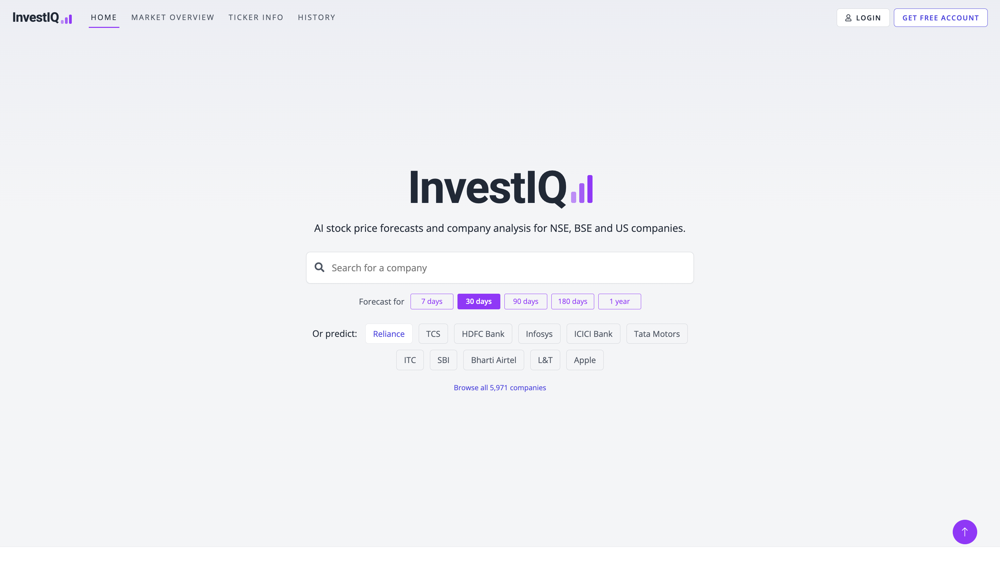
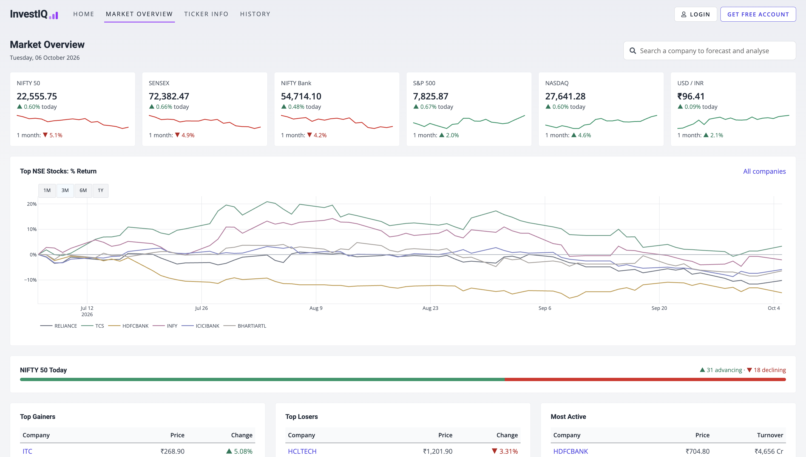
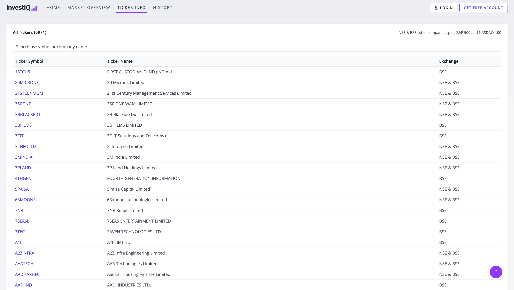
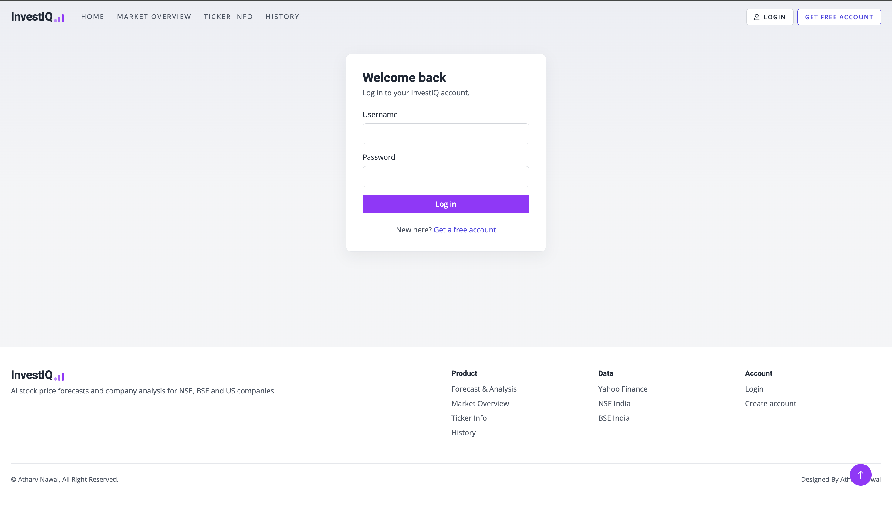

[//]: # (Hello welcome to my project 
  This project is already uploaded to my GitHub Account where I have deployed this project
  You can find the project here: https://github.com/Kumar-laxmi/Stock-Prediction-System-Application
)

[](https://github.com/AtharvNawal/Stock-Prediction-System-Application/actions/workflows/ci.yml)

## Introduction
<p>
  Predicting stock prices is a cumbersome task as it does not follow any specific pattern. Changes in the stock prices are purely based on supply and demand during a period of time. In order to learn the specific characteristics of a stock price, we can use algorithm to identify these patterns through machine learning. One of the most well-known networks for series forecasting is LSTM (long short-term memory) which is a Recurrent Neural Network (RNN) that is able to remember information over a long period of time, thus making them extremely useful for predicting stock prices. RNNs are well-suited to time series data and they are able to process the data step-by-step, maintaining an internal state where they cache the information they have seen so far in a summarised version. The successful prediction of a stock's future price could yield a significant profit.
</p>

## Aim
<p> 
  To predict stock prices according to real-time data values fetched from API.
</p>

## Objective
<p>
  The main objective of this project is to develop a web application that can predict stock price based on real-time data.  
</p>

## Project Scope
<p>
  The project has a wide scope, as it is not intended to a particular organization. This project is going to develop generic software, which can be applied by any businesses organization. Moreover it provides facility to its users. Also the software is going to provide a huge amount of summary data. 
</p>
  
## Technology Used:
- #### Languages:
  - 
  - 
  - 
  - 
- #### FrameWork:
  - 
  - 
  - 

- #### Deployment:
  - Click to see deployement (NOTE: Deployement not working): <a href="https://stock-prediction-system.herokuapp.com/"></a>
- #### Machine-Learning Algorithms:
  - **CNN + BiLSTM + Attention**, **1D CNN**, **Transformer encoder**, **Ridge regression**, and an inverse-error **weighted ensemble**, compared against a naive baseline

- #### ML/DL:
  - 
  - 
  - 
- #### Database:
  - 
- #### API used for:
  - Yahoo Finance API 
  - REST API
- #### IDE:
  - 
  - 
  - 
- #### OS used for testing:
  - 
  - 
  - 

- #### Designed using:
  - 
  - 

## Prerequisites:
Python 3.11. All dependencies are pinned in `requirements.txt` (app) and `requirements-dev.txt` (lint, coverage and security tools).

## Project Installation:
**STEP 1:** Clone the repository from GitHub.
```bash
  git clone https://github.com/AtharvNawal/Stock-Prediction-System-Application.git
  cd Stock-Prediction-System-Application
```

**STEP 2:** Create and activate a virtual environment.
```bash
  python3 -m venv .venv
  source .venv/bin/activate        # Windows: .venv\Scripts\activate
```

**STEP 3:** Install the dependencies (CPU-only torch keeps the download small).
```bash
  pip install --extra-index-url https://download.pytorch.org/whl/cpu -r requirements-dev.txt
```

**STEP 4:** Configure the environment. Settings come from environment variables (see `.env.example`); debug mode is off unless you turn it on.
```bash
  export DJANGO_DEBUG=1            # Windows PowerShell: $env:DJANGO_DEBUG="1"
  export SQLITE_PATH=./db.sqlite3
```

**STEP 5:** Migrate and run.
```bash
  python manage.py migrate
  python manage.py runserver
```

**STEP 6:** Run the checks CI runs.
```bash
  ruff check .
  bandit -c pyproject.toml -r app core scripts -ll
  coverage run manage.py test app && coverage report
```

## CI/CD Pipeline
GitHub Actions runs two workflows (`.github/workflows/`):

| Workflow | Trigger | Jobs |
| --- | --- | --- |
| **CI** (`ci.yml`) | every push and pull request | **Lint** (ruff) -> **Tests** (migration check, `check --deploy`, 52 tests with coverage); **Security scan** (Bandit, pip-audit) in parallel; then **Docker build** |
| **CD** (`cd.yml`) | CI passed on `main` | **Publish** the image to `ghcr.io/<owner>/<repo>` tagged with the commit SHA and `latest` -> **Deploy** via `DEPLOY_HOOK_URL` (optional approval gate on the `production` environment) |

Dependabot (`.github/dependabot.yml`) opens weekly update PRs for pip packages, GitHub Actions and the Docker base image; each goes through CI.

To enable deployment, add a `DEPLOY_HOOK_URL` repository secret (for example a Render or Railway deploy hook), and set `DJANGO_SECRET_KEY`, `DJANGO_ALLOWED_HOSTS`, `DJANGO_CSRF_TRUSTED_ORIGINS` and `RATE_LIMIT_TRUSTED_PROXIES=1` on the host. Heroku can still use the `Procfile`, which runs migrations in its release phase.

## Security
- **Rate limiting with the token bucket algorithm** (`app/security.py`): per client and policy, e.g. 5 login attempts a minute (brute-force protection) and 6 forecasts a minute (each trains four neural networks). Over the limit returns `429` with `Retry-After`. `X-Forwarded-For` is only trusted for the configured number of proxies, so clients can't spoof their way past the limit.
- **Argon2id password hashing**: memory-hard, so offline guessing is far more expensive than with PBKDF2. Existing PBKDF2 hashes upgrade on next login. Minimum password length is 10.
- **No secrets in code**: `SECRET_KEY` is read from the environment and the app refuses to start without it when debug is off.
- **Production hardening** when `DEBUG` is off: HTTPS redirect, HSTS, secure and HttpOnly cookies, `X-Frame-Options: DENY`, `nosniff`, a strict referrer policy; `manage.py check --deploy` passes with no warnings.
- **Supply chain**: Django upgraded to 5.2 LTS (4.2 had 9 known CVEs), pip-audit and Bandit in CI, Dependabot updates, and the container runs as a non-root user.

## Code Structure (OOP)
| Module | Classes and patterns |
| --- | --- |
| `app/forecasting.py` | `Forecaster` abstract base with a template method (`train`/`predict`); `NeuralForecaster`, `RidgeForecaster`, `NaiveForecaster` subclasses (polymorphism); `WeightedEnsemble` (composite); `StandardScaler`/`TargetScaler` fit on training data only; `ForecastPipeline`; `ForecastService` with an injected cache and data source |
| `app/caching.py` | `Cache` interface; `LRUCache` and `TTLCache` (inheritance), thread-safe |
| `app/companies.py` | `CompanyDirectory` encapsulates the company list: symbol resolution, listings, peers, ranked search; `Listing` named tuple |
| `app/security.py` | `TokenBucket`, `RatePolicy`, `RateLimiter`, `RateLimitMiddleware` |

## Output Screen-shots:
Click any screenshot to open the live app: **[investiq-nyay.onrender.com](https://investiq-nyay.onrender.com/)**

The Home page: search any NSE, BSE or US company (with live suggestions), pick a forecast horizon from 7 days to 1 year, or start from a popular company.
[](https://investiq-nyay.onrender.com/)

The Market Overview page shows the main indices (NIFTY 50, SENSEX, NIFTY Bank, S&P 500, NASDAQ, USD/INR) with today's change and a one-month trend, the % return of top NSE stocks, and today's NIFTY 50 gainers, losers and most active stocks.
[](https://investiq-nyay.onrender.com/)

The Ticker Info page lists all 5,971 supported companies with their exact NSE/BSE symbols, searchable by symbol or name. Each symbol opens that company's AI forecast and analysis.
[](https://investiq-nyay.onrender.com/)

Users can create a free account and log in.
[](https://investiq-nyay.onrender.com/)


## Disclaimer
<p>
This software is for educational purposes only. USE THE SOFTWARE AT YOUR OWN RISK. THE AUTHORS AND ALL AFFILIATES ASSUME NO RESPONSIBILITY FOR YOUR TRADING RESULTS. Do not risk money which you are afraid to lose. There might be bugs in the code - this software DOES NOT come with ANY warranty!
</p>
